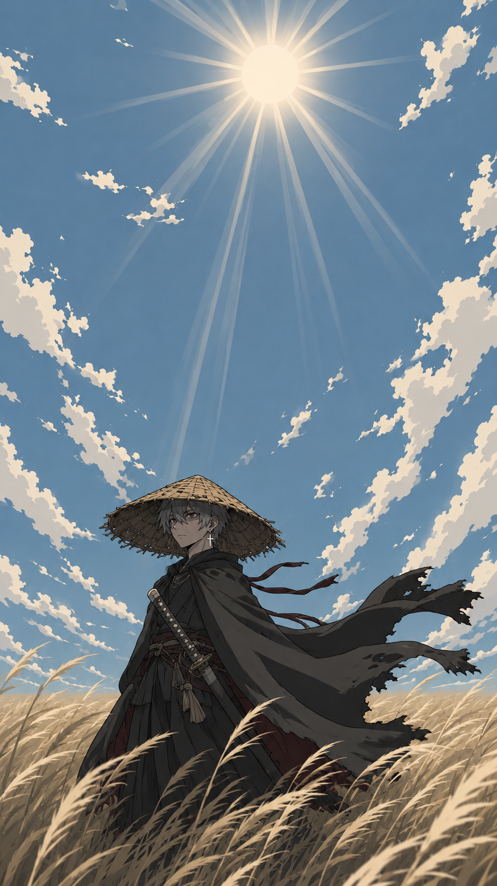
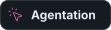
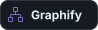
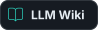
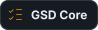
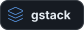
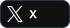

### 👋 hi, I'm wounds.

**vibe coder, web designer, game designer, and content creator.**

I build agent tools, creative workflows, and strange little systems where AI gets access to real devices.

**vibe-coded software. human-written words.**

<pre>
🤖 vibe coding • AI agents • automation
⌨️ codex • claude code • custom skills
🎨 gpt image 2 • ideogram • reve
🐧 macOS • game development • experimenting
🧰 tools I've worked with: claude code • claude design • codex
   opencode • notebookLM • obsidian • n8n
</pre>

  
  
  
  
  

 

### 🌤️ outside the terminal

I'm into gameplay-first single-player and indie games, moddable gadgets, mechanical keyboards, Japanese anime trading cards, and the pure joy of typing.

I'm also the creator of the **wounds** and **[wounds.dev](https://wounds.dev/)** brands.

native Russian speaker. English when necessary. still waiting for neuralese.

  

  
  
  
  

<!-- This repository powers the public @howdeploy profile. -->